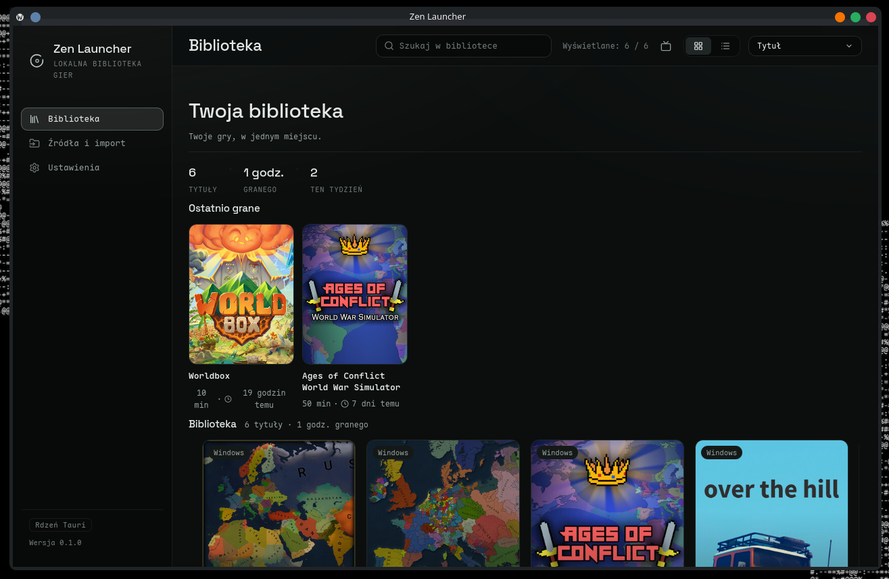
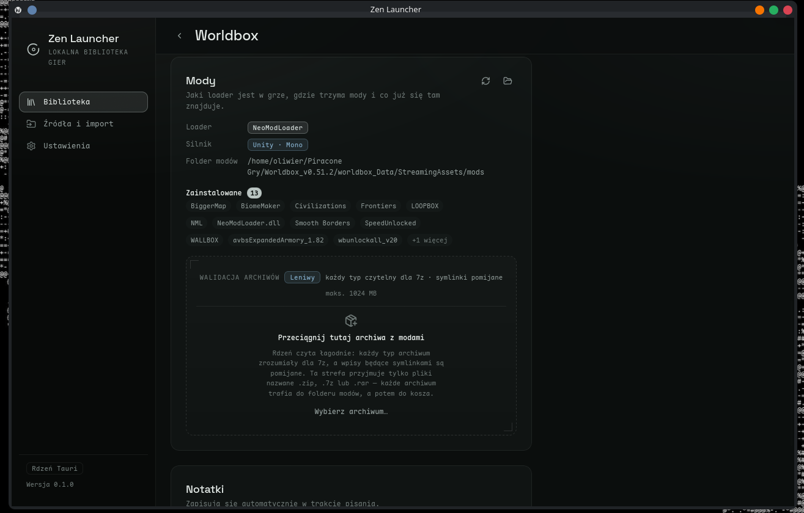
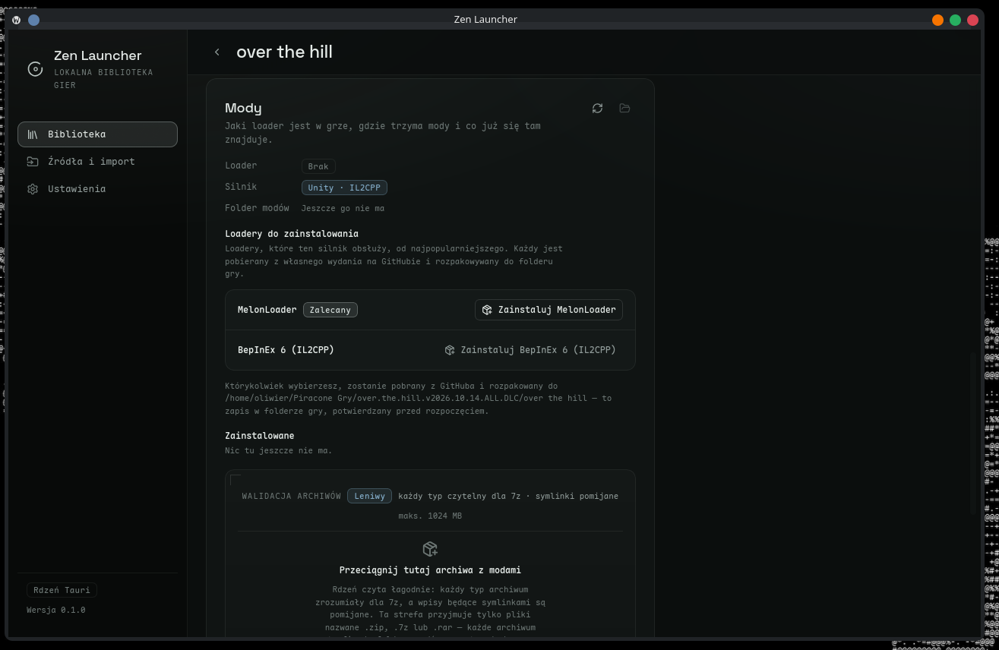

# Zen Launcher

[](LICENSE)
[](https://github.com/ace2821/Zen-Launcher/releases)
[](-)
[](https://v2.tauri.app/)

Local-first game library manager and launcher for Linux — organize, launch and
mod the games you already own: DRM-free store purchases, freeware, plain game
folders and Windows titles through Wine. No store clients, no accounts, no
telemetry.

| Library | Mods — installed | Mods — install |
| :---: | :---: | :---: |
|  |  |  |

## What it does

- **Library** — scans game folders you point it at, keeps cover art (Steam
  store art search with monogram fallbacks), tracks playtime and recents, and
  supports favorites, notes, tags and hiding.
- **Launch** — per-game options (executable, arguments, working directory,
  environment), Windows titles run through Wine with a managed prefix per
  game; GameMode and MangoHud toggles; every session is recorded with
  duration and exit code.
- **Mods** — detects what a game runs (BepInEx 5/6, MelonLoader, NeoModLoader,
  MSC Mod Loader, tModLoader, CLEO 5/4 & CLEO Redux, Script Hook IV/V, Frosty)
  and can install the download-installable ones straight from their GitHub
  releases; manual-install loaders get official-page links instead. Mod
  archives (`zip` / `7z` / `rar`) can be dropped onto the game and are unpacked
  into the loader's mods folder with redundant-file handling. Loaders Zen
  installed can be checked for updates and reinstalled.
- **Multiplayer clients** — GTA SA/VC-style client installs are detected
  (SA-MP, FiveM, MTA) and surfaced as badges; SA-MP games get structured
  host/port/nickname options that map to the client's launch flags.
- **Big Picture** — a console-style, gamepad-friendly layout (d-pad/shoulder
  navigation) reusing the same library data.

## Install

**AppImage** (works on any glibc-based distro) — grab the latest release from
[Releases](https://github.com/ace2821/Zen-Launcher/releases), then:

```bash
chmod +x "Zen Launcher_*.AppImage"
./"Zen Launcher_*.AppImage"
```

**Flatpak** — the Flathub submission is in progress; this README gets the
`flatpak install` command once the app is live on the store. Until then, you
can build the Flatpak yourself from the manifest in [`flatpak/`](flatpak/README.md).

**Build from source** (Arch / CachyOS as an example; equivalent packages
exist on other distros):

```bash
sudo pacman -S --needed webkit2gtk-4.1 patchelf
bun install
bun run tauri dev      # full app (needs system deps above)
bun run dev            # frontend only, mock IPC, no backend needed
```

Checks used during development:

```bash
cargo test --manifest-path src-tauri/Cargo.toml
bun run test
bunx tsc --noEmit
```

## Windows titles & Wine

Windows executables are launched via the system `wine`, with one prefix per
game (`<dataDir>/prefixes/<game id>`) so unrelated games don't share a
registry/c-drive. `cmd /c` is used for `.bat`/`.cmd` launchers, AppImages get
their exec bit set automatically. Known limitation: only the direct child is
supervised, so wrapper-style launchers that exit immediately may close the
session early — tracked in
[`docs/INTERFACES.md`](docs/INTERFACES.md).

## Project layout

- [`src-tauri/`](src-tauri/) — Rust core: scanner, library db, launch
  pipeline, mods engine, IPC commands
- [`src/`](src/) — React front-end (Tauri v2 IPC, mock IPC for tests/dev)
- [`docs/DESIGN.md`](docs/DESIGN.md) — design document
- [`docs/INTERFACES.md`](docs/INTERFACES.md) — IPC command + data contract
- [`flatpak/`](flatpak/README.md) — Flathub packaging (manifest, metainfo,
  smoke-test build)

## Roadmap

- Flathub publish (with bundled Wine for Windows titles inside the sandbox)
- More multiplayer client adapters (voice/EAC-aware wrappers)
- Scheduled loader update checks instead of on-demand only
- Cover art from more providers

## License

[MIT](LICENSE)
